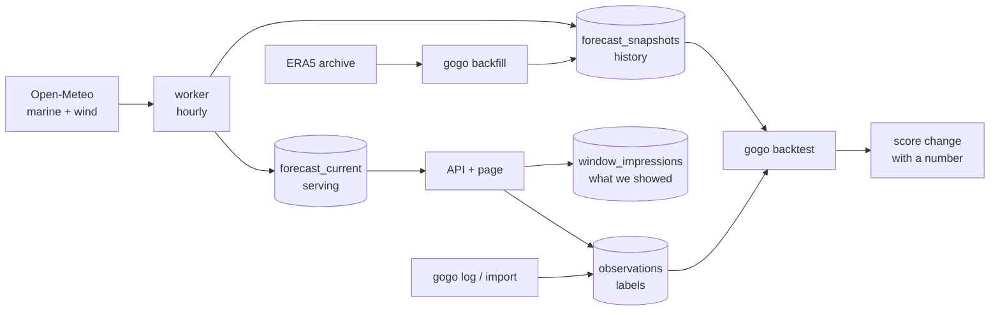

# Gogo


Go / no-go surf windows for the **Lisbon–Ericeira–Peniche** coast. The unit is a time
window — where to go, when, and why:

```text
Saturday 07:00–10:00 · Ribeira d'Ilhas · 78
offshore, incoming mid, 1.3 m @ 11 s NW
```

After a session, a card asks how it actually was, **before** showing what we predicted.
Those answers, joined to the forecast we stored at the time, are the training signal the
score improves against. No feed, no LLM in the path, no score change without a backtest
number.

## Table of Contents

- [Overview](#overview)
- [Architecture](#architecture)
- [Status](#status)
- [Quick Start](#quick-start)
- [Commands](#commands)
- [Logging sessions](#logging-sessions)
- [Improving the score](#improving-the-score)
- [Deployment](#deployment)
- [Project Structure](#project-structure)
- [Roadmap](#roadmap)
- [Attribution](#attribution)

## Overview

| Piece | What it does |
|---|---|
| **Spots** | 16 spots in `src/gogo/data/coast.yml`: swell window, size range, wind, tide |
| **Score** | Deterministic, per hour; adjacent passing hours become a window, ranked by mean then length (`v4`) |
| **Worker** | Fetches Open-Meteo marine + wind hourly into Postgres; keeps every changed forecast |
| **Page** | Phone UI (React + TS): ranked windows for any day this week, plus the blind log card |
| **Labels** | `observations` from the page, `gogo log`, or a CSV of remembered sessions |
| **Harness** | `gogo backtest`: labels × what was knowable at the time → ranking accuracy vs baselines |

Rules that hold everywhere:

- **UTC inside, Lisbon at the edges.**
- **Worker writes, API reads.** The API never calls Open-Meteo.
- **Serving reads `forecast_current`; evaluation reads `forecast_snapshots` at an as-of.**
- **Reanalysis is never served.** `gogo backfill` writes analysis rows only.
- **The log card cannot show our score** until the answer is stored.
- **Fixture labels are quarantined** by `is_synthetic` and excluded from every metric.

## Architecture



## Status

**Stage 3 — improve the score, with a number attached.** The pipeline, harness and host
are done. **Labels are the bottleneck:** the physics candidates below are built and wait
for real same-day pairs.

| Stage | Contents | State |
|---|---|---|
| 0 · Foundations | UTC discipline, versioned score + spot specs, observations, impressions, migrations | done |
| 1 · Labels | windows as ranges, any day, phone page, worker, VPS, import | built; **~100 labels: not yet** |
| 2 · Harness | as-of features, event-grouped dataset, 5 metrics × 5 baselines, `gogo backtest` | done |
| 3 · Better score | v3 wind/tide fixes, v4 tide timing; size / taper / shadow / rays candidates | candidates waiting for labels |
| 4 · Groups | invite-only accounts, spec overlays over a global label pool | later |

## Quick Start

Needs [uv](https://docs.astral.sh/uv/) and [OrbStack](https://orbstack.dev) (Postgres).
Node only for the page.

```bash
make install        # Python deps from uv.lock
make up             # Postgres, then gogo migrate
make test
make fetch          # Open-Meteo → Postgres
make weekend-db     # score the stored forecast, print Saturday
make ui && make web # build and serve the page, key "devkey"
```

Defaults match `docker-compose.yml` (`gogo`/`gogo`/`gogo` on `localhost:5432`). Copy
`.env.example` to `.env` only to change them.

## Commands

| Command | Does |
|---|---|
| `gogo fetch` | One Open-Meteo cycle → snapshots + current |
| `gogo worker` | The same, hourly, with backoff; `--once` for one cycle |
| `gogo health` | Exit 1 if the forecast is stale or a spot has no hours; pings `GOGO_HEARTBEAT_URL` only when healthy |
| `gogo weekend [--db]` | Print a day's ranked windows (fixture, live, or stored) |
| `gogo backfill --from --to` | ERA5 reanalysis → snapshots, `is_analysis` |
| `gogo log <spot> …` | Record one session |
| `gogo import <csv> [--dry-run]` | Record remembered sessions in bulk |
| `gogo backtest [--candidate …]` | Accuracy vs baselines; candidates vs the served score |
| `gogo demo [--purge]` | Fixture labels for harness work — never real data |
| `gogo migrate` | Apply `src/gogo/migrations/` |

| Make target | Does |
|---|---|
| `make ui-dev` / `make ui-types` | Vite with hot reload / regenerate client types (CI diffs them) |
| `make phone` | Serve the page on the LAN |
| `make backtest` / `make backtest-candidates` | The harness / every candidate |
| `make nazare` | Validate the ray tracer on the Nazaré canyon (`eval` group) |
| `make host` / `host-web` / `host-public` | Prod: worker / + page / + Caddy and a domain |
| `make tunnel` | The host's page on `localhost:8088` over SSH |
| `make import-host FILE=… [WRITE=1]` | Import a CSV onto the host, then delete it |

## Logging sessions

```bash
gogo log ribeira --start 07:15 --end 09:00 --residual -1 --fault tide:-1 --crowd busy
gogo log coxos   --start 08:00 --end 08:30 --kind checked --residual -2
```

| Field | Meaning |
|---|---|
| `--residual` | −2..+2 against what we predicted |
| `--rating` | 1..5, absolute — for sessions nothing was predicted to (imports, the blind card) |
| `--kind` | `surfed`, `checked` (looked and left), `cam` |
| `--fault` | The gate we got wrong, e.g. `size:-1`, `tide:-1` |

Remembered sessions, as CSV (`date,spot,start,end` required):

```csv
date,spot,start,end,kind,rating,crowd,faults,note
2026-03-14,ribeira,07:15,09:00,surfed,4,ok,,clean lines on the point
2026-03-14,coxos,09:15,09:30,checked,2,busy,size:-1,smaller than it should have been
```

What counts is **comparable same-day pairs**: two spots on one day with different
ratings. `--dry-run` reports that number. Log `checked` rows for spots you looked at and
skipped, and use the whole rating range. For sessions before the worker started, run
`gogo backfill` over those days first.

All labels belong to one handle (`GOGO_HANDLE`, default `max`); a second handle would
store one session as two labels.

## Improving the score

A change is built as a **candidate**: a `ScoreOptions` flag that serving never sets. The
backtest scores it on the same labelled pairs as the served score and reports the
difference with an interval, plus how many stored days it would change the headline on.

| Candidate | Idea | Moves headline on |
|---|---|---|
| `size_period:typical` | Long-period swell breaks bigger (Komar & Gaughan) | 16% of days |
| `dir_taper:45` | Open beaches take swell past the window edge, height cut by refraction | 13% |
| `shadow:20` | Headlands diffract swell into their lee (OSM coastline) | 32% |
| `rays:size` | Reverse ray tracing over EMODnet bathymetry gives size per direction × period | 37% |

The tracer reproduces Snell's law, the Nazaré canyon's focusing and 16 local facts
(`tests/test_rays_knowledge.py`). Out of scope: anything that needs the seabed at the
break (sandbars, reef ledges); public bathymetry is ~100 m coarse there.

## Deployment

One image, one Postgres, on a small VPS (2 vCPU / 4 GB, Debian). The worker matters
most: forecast history cannot be recovered later.

1. Provider firewall: inbound 22 and ICMP only. Never 5432.
2. Docker from Docker's apt repo; 2 GB swap.
3. Clone, then generate the only required secret on the box:
   ```bash
   printf 'POSTGRES_PASSWORD=%s\n' "$(openssl rand -hex 32)" > .env && chmod 600 .env
   ```
4. `make host` — builds, migrates behind an advisory lock, fetches immediately.
5. Backfill a year once:
   `docker compose -f docker-compose.prod.yml exec worker gogo backfill --from 2025-09-01 --to 2026-09-03`
6. Cron `scripts/backup.sh` nightly (verified dump, 14 kept, optional `GOGO_BACKUP_DEST`
   rsync copy). Restore one once.
7. Set `GOGO_HEARTBEAT_URL` to an external cron monitor; the alert is the ping stopping.

**Reaching the page.** Private: `make host-web` on the box, `make tunnel` on the laptop.
Use an SSH alias (`HOST=`, default `gogo`) defined in your own `~/.ssh/config`. Public:
an `A` record, ports 80/443, `GOGO_DOMAIN` + `GOGO_WEB_SECRET` in `.env`, `make host-public`.
An unset `GOGO_WEB_SECRET` means the page is off, not open.

## Project Structure

```text
src/gogo/
├── data/coast.yml        # the spots — edit here first
├── data/rays.json        # traced refraction per spot (scripts/wave_rays.py)
├── score.py              # pure, tested; SCORE_VERSION and ScoreOptions
├── tide.py               # low / mid / high per tide cycle
├── ingest/               # openmeteo.py forecast, archive.py reanalysis
├── worker.py             # fetch_once, run_forever, backfill
├── store.py              # Postgres
├── serving.py            # pick a day, score it, record the impression
├── api.py / schemas.py   # FastAPI; schemas.py generates the client's types
├── web.py                # server-rendered login, app shell
├── features.py           # what was knowable at an as-of
├── eval/                 # dataset, metrics, baselines, candidates, backtest
├── importer.py / demo.py # CSV labels / fixture labels
└── migrations/           # numbered SQL, applied by gogo migrate
web/                      # Vite + React + TS → src/gogo/static/app
scripts/                  # backup, spot geometry, wave rays, tide check
tests/                    # pytest against an isolated gogo_test database
```

## Roadmap

| Next | Why |
|---|---|
| **~100 real labels** across several swell events | The Stage 1 gate; nothing below can be measured without them |
| Ship or drop each candidate on its backtest number | The physics is built; labels decide it |
| Daylight veto from sunrise/sunset | Replaces the fixed 06–20 placeholder |
| Continuous tide (height + rate) | The three-phase proxy gives the score almost no intra-day resolution |
| Evening go / no-go push | Web push, email fallback |
| Public page: domain, accounts, invites | Invite-only is the anti-spam design |
| Ensemble spread as shown uncertainty | Say when we don't know |
| Group spec overlays over the global label pool | Private local knowledge, still backtestable |

## Attribution

Forecasts from [Open-Meteo](https://open-meteo.com/) (CC BY 4.0), using national wave and
weather models (Météo-France, DWD, ECMWF, NCEP, and others). Free Open-Meteo is
non-commercial; a paid plan or ads would need their customer endpoint.
